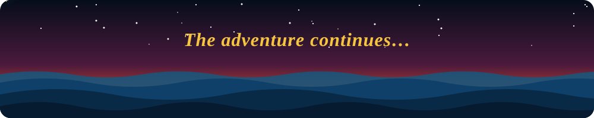

 

  

  

 

 

<!--
  Edit the icon IDs after "i=" to match YOUR stack. Full list: https://skillicons.dev
-->

<b>East Blue: core languages</b> 

  

<b>Alabasta: frontend & UI</b> 

  

<b>Water 7: backend, APIs & databases</b> 

  

<b>Skypiea: cloud, DevOps & CI/CD</b> 

  

<b>Wano: tools & platforms</b> 

  

<b>Dressrosa: design, animation & video</b> 

  

<b>Laugh Tale: AI, hardware & embedded</b> 

  

 

 

 

 

<!--
  Replace the three YOUR_... links below. Delete any badge you don't want.
-->

  

  

