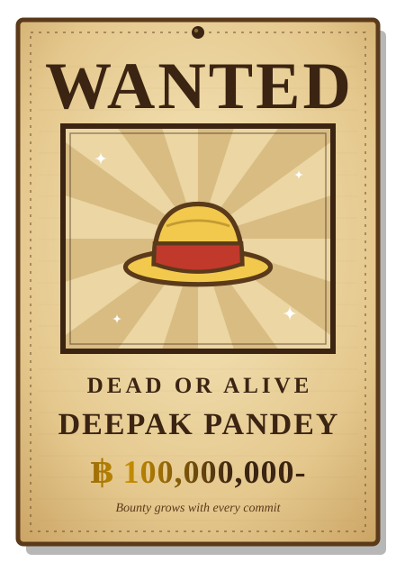

<div align="center">


<a href="https://github.com/YOUR_GITHUB_USERNAME">
  
</a>

<br/>



<br/>


</div>

---

<h2 align="center">📜 Captain's Log 📜</h2>

```text
┌──────────────────────────────────────────────────────────┐
│  Name         : Deepak Pandey  (he/him)                   │
│  Pirate Crew  : The Code Block Pirates                   │
│  Role         : Captain & Full-Stack Developer           │
│  Home Island  : YOUR CITY, India                         │
│  Dream        : Become the King of the Coders            │
│  Devil Fruit  : Code-Code Fruit (eats bugs for lunch)    │
│  Motto        : Write code, chase the dream              │
└──────────────────────────────────────────────────────────┘
```

---

<h2 align="center">🏴‍☠️ My Straw Hat Crew 🏴‍☠️</h2>

Every great captain needs a crew. Here's who handles what on my ship:

| Crew Role | Pirate | What They Do On My Ship |
|:--|:--|:--|
| 👑 Captain | **Luffy** | Full-stack development, the big dream, jumping in headfirst |
| 🧭 Navigator | **Nami** | Frontend and UI, charting the way users travel |
| ⚔️ Swordsman | **Zoro** | Backend and APIs, cutting through logic (sometimes gets lost, always recovers) |
| 🔧 Shipwright | **Franky** | Cloud, DevOps and CI/CD, keeping the ship afloat |
| 🍳 Cook | **Sanji** | Design, animation and video, serving things that look delicious |
| 🩺 Doctor | **Chopper** | Debugging and bug fixing, no patient left behind |
| 🎯 Sniper | **Usopp** | AI, hardware and embedded, long-range precision |
| 📚 Archaeologist | **Robin** | Docs, Linux and digging through ancient codebases |
| 🎻 Musician | **Brook** | Vibes. Soul. Coding to a good playlist |

---

<h2 align="center">🗺️ The Grand Line: My Tech Arsenal 🗺️</h2>

<div align="center">

**🌊 East Blue: Core Languages & Foundations**<br/>


**🏝️ Alabasta: Frontend & UI Engineering**<br/>


**⚙️ Water 7: Backend, APIs & Runtimes**<br/>


**☁️ Skypiea: Cloud, DevOps & CI/CD**<br/>


**🗡️ Wano: Tools, IDEs & Platforms**<br/>


**🎨 Dressrosa: Design, Animation & Video**<br/>


**🔮 Laugh Tale: AI, Hardware & Embedded**<br/>


</div>

---

<h2 align="center">📊 Bounty Board (GitHub Stats) 📊</h2>

<div align="center">


<br/>


</div>

---

<h2 align="center">🐍 Sea King Hunt (Contribution Snake) 🐍</h2>

<div align="center">

<!-- Uses the snake output from your existing GitHub Action -->


<br/><br/>


</div>

---

<h2 align="center">🏆 Treasure Cabinet (Trophies) 🏆</h2>

<div align="center">


</div>

---

<h2 align="center">🎻 Brook's Concert Hall: Keep Vibing 🎻</h2>

<div align="center">

<!--
  Your old Spotify card was showing a broken image, so it's disabled here.
  To bring it back, regenerate your link at https://spotify-github-profile.kittinunf.com
  then paste it below:

  
-->

*"Yohoho! Code is better with a soundtrack."*

</div>

---

<h2 align="center">🧭 Set Sail With Me: Let's Connect 🧭</h2>

<div align="center">

<a href="https://YOUR_PORTFOLIO_URL"></a>
<a href="https://www.linkedin.com/in/YOUR_LINKEDIN"></a>
<a href="https://x.com/YOUR_X_HANDLE"></a>
<!-- <a href="YOUR_STACKOVERFLOW_URL"></a> -->

<br/><br/>


</div>


